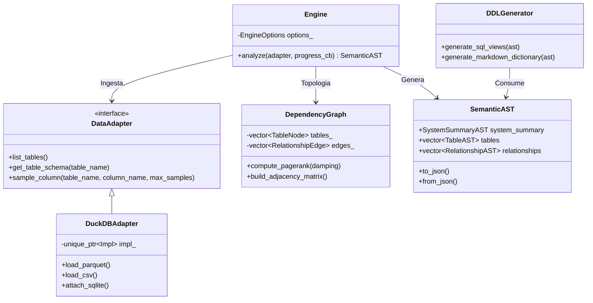

# Guía Técnica del Desarrollador: InteliData

Esta guía documenta la arquitectura interna, los patrones de diseño en **C++20**, la estabilidad binaria (ABI) y los algoritmos matemáticos implementados en **InteliData**.

---

## 1. Principios de Diseño en C++20

InteliData fue concebido como un motor de nivel de sistema con cero sobrecarga en tiempo de ejecución (*zero-cost abstractions*), con las siguientes decisiones de diseño:

1. **Estándar C++20 Estricto:**
   - **Conceptos (`<concepts>`):** En [`include/intelidata/common/Types.hpp`](file:///home/lucifer/proyectos/InteliData/include/intelidata/common/Types.hpp) se definen los conceptos `Numeric<T>`, `Arithmetic<T>` e `Integral<T>` para restringir plantillas en tiempo de compilación y mejorar los mensajes de error del compilador.
   - **Vistas en memoria (`std::span` y `std::string_view`):** Cero copias innecesarias de vectores y cadenas a lo largo del pipeline analítico.
   - **Concurrencia estándar (`<thread>`, `<atomic>`, `<latch>`):** Ejecución multihilo portable entre Linux y Windows sin llamadas a APIs nativas no estándar como `pthread` o `Win32 Threads`.

2. **Detección de Plataforma Portable:**
   - [`include/intelidata/common/Platform.hpp`](file:///home/lucifer/proyectos/InteliData/include/intelidata/common/Platform.hpp) normaliza directivas del compilador (`INTELIDATA_FORCE_INLINE`, detección de 64 bits mediante `static_assert(sizeof(void*) == 8)`).

---

## 2. Ingesta y Aislamiento ABI (Patrón PIMPL con DuckDB C API)

### 2.1. El Problema de la Incompatibilidad ABI de C++
Las bibliotecas precompiladas de DuckDB suelen compilarse con estándares ABI específicos (e.g. `_GLIBCXX_USE_CXX11_ABI=0` en librerías preconstruidas antiguas o distribuciones GNU modernas como GCC 16 en Arch Linux). La vinculación directa de clases C++ como `duckdb::Connection` o `duckdb::DuckDB` provoca errores de enlace (*undefined reference*) debido a diferencias de *mangling* en `std::__cxx11::basic_string`.

### 2.2. La Solución Adoptada
[`DuckDBAdapter`](file:///home/lucifer/proyectos/InteliData/include/intelidata/ingestion/DuckDBAdapter.hpp) implementa el patrón **PIMPL (*Pointer to Implementation*)** envolviendo exclusivamente la **API pura de C** (`duckdb.h`):
- Los encabezados públicos de InteliData **no** incluyen ningún encabezado de DuckDB.
- `DuckDBAdapter::Impl` gestiona los punteros opacos `duckdb_database` y `duckdb_connection`.
- Los destructores y métodos de movimiento (`std::unique_ptr<Impl>`) aseguran una gestión RAII estricta de memoria.
- **Resultado:** 100% de estabilidad binaria e interoperabilidad garantizada tanto en GCC/Clang (Linux) como en MSVC (Windows).

### 2.3. Detección Automática de Formatos en `DuckDBAdapter`
El constructor `DuckDBAdapter(const std::string& path)` detecta la extensión y el contenido:
- **`:memory:` o vacío:** Inicializa una instancia pura en memoria RAM.
- **`.sqlite` o `.db`:** Inicia en memoria y ejecuta `ATTACH 'path' AS sqlite_db (TYPE SQLITE); USE sqlite_db;`.
- **`.csv`:** Inicia en memoria y ejecuta `CREATE TABLE "<stem>" AS SELECT * FROM read_csv_auto('path');`.
- **`.parquet`:** Inicia en memoria y ejecuta `CREATE TABLE "<stem>" AS SELECT * FROM read_parquet('path');`.
- **DuckDB nativo:** Abre el archivo directamente mediante `duckdb_open(path.c_str(), &db)`.

Para listar tablas y esquemas con independencia del catálogo activo, se emplean los comandos canónicos de DuckDB:
```cpp
// Listar tablas activas
duckdb_query(conn, "SHOW TABLES;", &result);

// Obtener columnas, tipos y nulabilidad
duckdb_query(conn, "DESCRIBE \"nombre_tabla\";", &result);
```

---

## 3. Algoritmos Matemáticos y Núcleo de Perfilado

### 3.1. Acumulador de Welford Asociativo (`WelfordAccumulator`)
Basado en el trabajo de Philippe Pébay (Sandia National Laboratories, 2008):
- **Momentos centrales acumulados:** $M_1, M_2, M_3, M_4$.
- **Fórmula de combinación paralela (`combine`):**
  $$\delta = \mu_B - \mu_A$$
  $$\mu_{AB} = \mu_A + \delta \frac{n_B}{n_{AB}}$$
  $$M_{2,AB} = M_{2,A} + M_{2,B} + \delta^2 \frac{n_A n_B}{n_{AB}}$$
  $$M_{3,AB} = M_{3,A} + M_{3,B} + \delta^3 \frac{n_A n_B (n_A - n_B)}{n_{AB}^2} + 3 \delta \frac{n_A M_{2,B} - n_B M_{2,A}}{n_{AB}}$$
  $$M_{4,AB} = M_{4,A} + M_{4,B} + \delta^4 \frac{n_A n_B (n_A^2 - n_A n_B + n_B^2)}{n_{AB}^3} + 6 \delta^2 \frac{n_A^2 M_{2,B} + n_B^2 M_{2,A}}{n_{AB}^2} + 4 \delta \frac{n_A M_{3,B} - n_B M_{3,A}}{n_{AB}}$$
Permite calcular asimetría y curtosis exacta sobre terabytes de datos divididos en bloques sin degradación numérica.

---

### 3.2. Ley de Benford con $p$-value Analítico Cerrado (`Benford`)
Para evaluar el estadístico $\chi^2 = \sum_{d=1}^9 \frac{(O_d - E_d)^2}{E_d}$ con 8 grados de libertad:
La función de supervivencia (o probabilidad de cola) de una distribución $\chi^2$ con $\nu = 8$ grados de libertad corresponde a la función gamma incompleta superior regularizada $Q(\nu/2, \chi^2/2) = Q(4, s)$ con $s = \chi^2 / 2$.
Al ser $k = 4$ un número entero, la función tiene solución analítica exacta en forma cerrada:
$$Q(4, s) = e^{-s} \left( 1 + s + \frac{s^2}{2!} + \frac{s^3}{3!} \right) = e^{-s} \left( 1 + s + \frac{s^2}{2} + \frac{s^3}{6} \right)$$
Esto elimina la necesidad de enlazar librerías matemáticas pesadas como Boost.Math o GSL, manteniendo cero dependencias de runtime.

---

### 3.3. Resolución y Desambiguación de Dependencias de Inclusión (PIND)
Para prevenir falsos positivos triviales (como enteros pequeños $\{1, 2, 3, 4, 5\}$ contenidos en llaves foráneas gigantes):
1. **Identificación de Clave Primaria:** Se detecta la clave primaria canónica de cada tabla. Dos claves primarias autonuméricas no pueden vincularse entre sí salvo que compartan similitud léxica/consonántica (relación 1 a 1 de herencia).
2. **Puntuación Multidimensional:**
   $$\text{Score}(c_a \to c_b) = S(c_a \subseteq c_b) \cdot \left(\frac{|D(c_a)|}{|D(c_b)|}\right)^{0.2} \cdot (1 + 0.5 \cdot \text{SimLex}(c_a, c_b))$$
3. **Selección del Objetivo Óptimo:** Para cada columna de origen, se evalúan todos los destinos posibles y se selecciona el que maximiza la puntuación, eliminando aristas duplicadas espurias.

---

### 3.4. Álgebra Espectral y Particionamiento Laplaciano (`Spectral`)
- **Matriz de Adyacencia Simétrica:** $W = \frac{A + A^T}{2}$.
- **Laplaciano Normalizado:** $L_{\text{norm}} = I - D^{-1/2} W D^{-1/2}$.
- **Vector de Fiedler ($v_1$):** Es el vector propio correspondiente al segundo valor propio más pequeño ($\lambda_1$).
- **Particionamiento Espectral (*2-way Normalized Cut*):**
  $$\text{Cluster}(i) = \begin{cases} 1 & \text{si } v_1[i] \ge \text{mediana}(v_1) \\ 0 & \text{en caso contrario} \end{cases}$$
Divide el esquema en subdominios funcionales óptimos con corte de aristas mínimo.

---

## 4. Estructura de Clases y Flujo del Pipeline



---

## 5. Cómo Extender el Sistema

### 5.1. Agregar un Nuevo Adaptador de Datos (`DataAdapter`)
Para integrar una nueva base de datos (por ejemplo, PostgreSQL o ClickHouse):
1. Hereda de `intelidata::ingestion::DataAdapter` en `include/intelidata/ingestion/`.
2. Implementa los 3 métodos virtuales puros:
   ```cpp
   std::vector<std::string> list_tables() override;
   TableSchema get_table_schema(std::string_view table_name) override;
   std::vector<std::string> sample_column(std::string_view table_name, std::string_view column_name, Size max_samples) override;
   ```
3. Pasa tu adaptador directamente a `engine.analyze(mi_adaptador)`.

### 5.2. Agregar Nuevas Métricas al Perfilado Atómico
Para agregar una nueva métrica estadística (e.g. coeficiente de Gini o asimetría de Medcouple):
1. Añade la clase acumuladora en `include/intelidata/core/`.
2. Actualiza la estructura `ColumnProfile` en `src/pipeline/Engine.cpp`.
3. Incorpora el resultado en la inferencia de roles o en el `SemanticAST`.
4. Añade los casos de prueba unitarios en `tests/`.

---

## 6. Ejecución de Pruebas y Benchmarking

```bash
# Ejecutar todas las pruebas unitarias
ctest --test-dir build --output-on-failure

# Ejecutar una prueba específica con salida detallada de Catch2
./build/intelidata_tests "[welford]" -s
./build/intelidata_tests "[benford]" -s
./build/intelidata_tests "[engine]" -s
```
